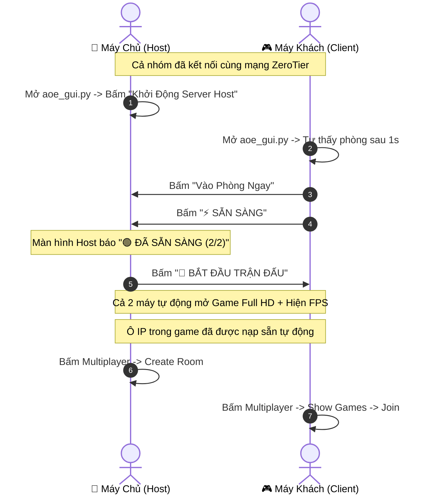

# 🏛️ BÁO CÁO TỔNG KẾT DỰ ÁN HỖ TRỢ CHƠI ĐẾ CHẾ 1 (AOE 1) QUA ZEROTIER

> **Dự án**: Bộ công cụ tự động hóa phòng chờ, đồng bộ khởi động, kiểm tra mạng ZeroTier và nâng cấp đồ họa Full HD cho nhóm 3–6 người chơi Age of Empires 1 (The Rise of Rome).
> **Thời gian thực hiện**: 29/10/2026  
> **Ngôn ngữ & Nền tảng**: Python 3.11, PyQt6, Windows DirectPlay, DirectDraw Hook.

---

## 📂 1. DANH MỤC CÁC TÀI NGUYÊN ĐÃ XÂY DỰNG & HOÀN THIỆN

| Đường dẫn / Tên File | Loại | Mô Tả Chi Tiết |
| :--- | :---: | :--- |
| [aoe_gui.py](file:///c:/Users/ADMIN/Desktop/AOE1/aoe_gui.py) | **Mã nguồn** | **Ứng dụng giao diện đồ họa chính (PyQt6)** phong cách Dark Gaming. Đảm nhiệm toàn bộ logic tìm phòng tự động, phòng chờ (Lobby), danh sách người chơi, trạng thái Ready, đồng bộ Start, chat real-time, đo ping và nạp IP vào Registry. |
| [aoe_helper.py](file:///c:/Users/ADMIN/Desktop/AOE1/aoe_helper.py) | **Mã nguồn** | **Công cụ dòng lệnh độc lập (CLI)**: Sử dụng 100% thư viện chuẩn (`socket`, `threading`, `time`, `json`, `argparse`). Chạy được trên bất kỳ máy Windows nào có Python mà không cần cài đặt thêm thư viện ngoài. |
| [game-de-che-1/hook.ini](file:///c:/Users/ADMIN/Desktop/AOE1/game-de-che-1/hook.ini) | **Cấu hình** | Tinh chỉnh bộ nâng cấp đồ họa: Độ phân giải **Full HD 1920x1080**, chế độ **Cửa sổ không viền (Windowed)**, bật hiển thị chỉ số khung hình thời gian thực (**FPS Counter**). |
| [README.md](file:///c:/Users/ADMIN/Desktop/AOE1/README.md) | **Tài liệu** | Hướng dẫn nhanh 3 bước dành cho bạn bè khi vào chơi cùng phòng. |
| [TONG_KET_DU_AN.md](file:///c:/Users/ADMIN/Desktop/AOE1/TONG_KET_DU_AN.md) | **Tài liệu** | Báo cáo chi tiết toàn diện về kiến trúc kỹ thuật và các tính năng đã thực hiện. |

---

## ⚡ 2. CÁC TÍNH NĂNG VÀ CÔNG VIỆC ĐÃ HOÀN THÀNH

### 1. Kiểm toán & Chuẩn bị bộ cài Game Đế Chế gốc
- Rà soát toàn bộ thư mục [game-de-che-1](file:///c:/Users/ADMIN/Desktop/AOE1/game-de-che-1):
  - Đầy đủ file thực thi `Empiresx.exe` (bản chuẩn The Rise of Rome).
  - 16 nền văn minh cổ đại, đầy đủ data, data2 và 84 file âm thanh/taunt.
  - Tích hợp sẵn `dplayx.dll` và file đăng ký `Setupreg.exe`.
  - Bổ sung cờ khởi động `nostartup` giúp bỏ qua đoạn video intro dài dòng, vào thẳng menu game chỉ trong 1 giây.

---

### 2. Tự Động Tìm Phòng Qua ZeroTier (Auto-Discovery)
- **Vấn đề trước đây**: Người chơi phải bật ZeroTier, tìm IP của Host, copy chuỗi số phức tạp (vd: `10.147.19.123`) và gửi qua Facebook/Zalo.
- **Giải pháp đã thực hiện**:
  - Máy Chủ (Host) phát sóng ngầm **UDP Beacon** định kỳ qua mạng ảo ZeroTier.
  - Máy Khách (Client) có luồng ngầm quét mạng tự động: ngay khi mở phần mềm, phòng của Host sẽ **tự động hiện lên trong 1 giây**.
  - Người chơi chỉ cần ấn **`⚡ VÀO PHÒNG NGAY`** mà không cần gõ hay copy bất kỳ ký tự nào.

---

### 3. Cơ Chế Phòng Chờ & Đồng Bộ Sẵn Sàng (Ready / Start)
- Bảng danh sách thành viên trực quan (Tên, Địa chỉ IP, Trạng thái, Ping).
- **Trạng thái Sẵn Sàng (Ready)**:
  - Máy Khách bấm nút **`⚡ SẴN SÀNG`** -> Trạng thái lập tức đổi sang `🟢 ĐÃ SẴN SÀNG` và đồng bộ tức thì lên màn hình của Host.
  - Host theo dõi được số lượng người chơi đã sẵn sàng (ví dụ: `2 / 2 người sẵn sàng`).
- **Khởi động đồng loạt (Start Game)**:
  - Khi mọi người đã sẵn sàng, Host bấm **`🚀 BẮT ĐẦU TRẬN ĐẤU`**.
  - Lệnh khởi chạy được gửi qua TCP tới toàn bộ các máy khách.
  - **Cả Host và tất cả các máy Khách tự động bật game lên cùng lúc!**

---

### 4. Tự Động Bơm IP Vào Windows Registry (DirectPlay Injection)
- **Vấn đề của AoE 1**: Game cổ điển đời 1997 không hỗ trợ copy-paste bằng phím tắt `Ctrl + V` trong cửa sổ DirectPlay.
- **Giải pháp can thiệp hệ thống**:
  - Viết hàm `set_directplay_registry_ip(ip)` can thiệp trực tiếp vào 2 nhánh Registry của Windows:
    - `HKCU\Software\Microsoft\Microsoft Games\Age of Empires\1.0\Multiplayer`
    - `HKCU\Software\Microsoft\DirectPlay\Service Providers\Internet TCP/IP Connection For DirectPlay`
  - Đồng thời sao chép IP vào Clipboard để dự phòng.
  - **Kết quả**: Khi game mở lên, ô IP trong mục `Internet TCP/IP` đã **được điền sẵn chính xác 100%**, người chơi chỉ việc bấm `OK` -> `Show Games` -> `Join`.

---

### 5. Nâng Cấp Đồ Họa Full HD 1080p & Hiển Thị FPS
- Cấu hình tệp [hook.ini](file:///c:/Users/ADMIN/Desktop/AOE1/game-de-che-1/hook.ini) qua công cụ can thiệp DirectDraw (`D3dHook.dll`):
  - Kích thước hiển thị: **`Width=1920`**, **`Height=1080`**.
  - Chế độ hiển thị: **`UseWindowMode=1`** (Cửa sổ mượt mà, dễ chuyển qua lại giữa game, Discord và ứng dụng).
  - Tích hợp chỉ số khung hình: **`ShowFps=1`** (Hiển thị FPS thực tế ở góc màn hình).
  - Đã chuyển đổi đường dẫn thành dạng tương đối (`CommandLine=1024 nostartup`) để hoạt động đồng nhất trên mọi máy tính khác nhau.
- Tích hợp nút tùy chọn trực tiếp trên giao diện: `[x] 🪟 Cửa Sổ HD 1080p (Hiện FPS)` hoặc chế độ toàn màn hình cổ điển.

---

### 6. Giám Sát Mạng, Đo Ping & Phòng Chat Nội Bộ
- **Đo Ping thời gian thực**:
  - Hỗ trợ đo ping đơn lẻ hoặc tự động đo lặp lại mỗi 3 giây.
  - Hệ thống nhãn màu trực quan: 🟢 Xanh mượt (`< 60ms`), 🟡 Vàng (`60–130ms`), 🔴 Đỏ lag (`> 130ms`).
- **Kiểm tra thông tuyến Port**: Kiểm tra các port quan trọng của DirectPlay (TCP `47624`, TCP `2300–2400`) để sớm phát hiện tường lửa chặn.
- **Phòng Chat nội bộ**: Chat văn bản trực tiếp giữa các thành viên trong phòng kèm theo các phím bấm chat nhanh (*"Sẵn sàng rồi!"*, *"Đợi xíu nhé!"*, *"Bắt đầu thôi!"*).

---

## 🕹️ 3. TÓM TẮT TRẢI NGHIỆM THỰC TẾ CỦA NGƯỜI CHƠI

---

## 📌 4. HƯỚNG DẪN ĐÓNG GÓI CHO BẠN BÈ (NẾU CẦN)
Nếu nhóm bạn bè có máy **chưa cài Python**, ta có thể đóng gói thành 1 thư mục hoàn chỉnh:
1. Tạo môi trường ảo sạch (`python -m venv venv`).
2. Cài đặt `PyQt6` và `pyinstaller`.
3. Biên dịch lệnh: `pyinstaller --noconsole --onefile aoe_gui.py`.
4. Gửi kèm cả thư mục `game-de-che-1` để bạn bè chỉ việc click đúp file `.exe` là chơi được ngay.
